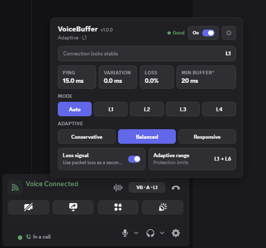

<h1 align="center">VoiceBuffer</h1>

<p align="center"><strong>Adaptive and manual buffering for incoming voice on Discord Desktop.</strong><br>
An experimental plugin for Vencord and Equicord.</p>

<p align="center"><a href="#requirements">Requirements</a> · <a href="#install">Install</a> · <a href="#controls">Controls</a> · <a href="#check-the-buffer">Check the buffer</a></p>

<p align="center">
  
</p>

When voice packets arrive unevenly, some miss their playback deadline. VoiceBuffer asks Discord to wait a little longer so more of those packets can arrive in time. You trade some playback delay for a chance at fewer cuts. The adjustment affects the voice **you hear** in calls. Your microphone and screen-share playback are outside its scope.

<a name="requirements"></a>

## 🧰 Requirements

Start with **Discord Desktop with Equicord or Vencord already installed**. To use the terminal commands below, also install these tools and make sure your terminal can find them.

- **Node.js 22 or newer.** [Download Node.js](https://nodejs.org/en/download)
- **Git.** [Download Git](https://git-scm.com/downloads)
- **pnpm.** [Install pnpm](https://pnpm.io/installation)

<a name="install"></a>

## 📦 Install

### Equicord or Vencord with the regular installer

1. **Quit Discord Desktop.** On Windows, use the Discord icon in the system tray to quit fully. Open **Git Bash** or **PowerShell 7** in a folder where you want to keep the build.
2. **Copy one command**, for the mod you already use, and press Enter. It builds a copy of your mod with VoiceBuffer included and opens the installer.

   **Equicord**

   ```sh
   git clone --depth 1 https://github.com/Equicord/Equicord.git Equicord-VoiceBuffer && cd Equicord-VoiceBuffer && git clone --depth 1 https://github.com/luizbizzio/voicebuffer.git src/userplugins/voicebuffer && pnpm install --frozen-lockfile && pnpm build && pnpm inject
   ```

   **Vencord**

   ```sh
   git clone --depth 1 https://github.com/Vendicated/Vencord.git Vencord-VoiceBuffer && cd Vencord-VoiceBuffer && git clone --depth 1 https://github.com/luizbizzio/voicebuffer.git src/userplugins/voicebuffer && pnpm install --frozen-lockfile && pnpm build && pnpm inject
   ```

3. **Select your Discord installation** in the installer and click **Install**. Choose **Discord Stable** if you use the standard Discord app.
4. **Open Discord and enable VoiceBuffer** from **User Settings → Equicord or Vencord → Plugins**. Join a voice call to see the **VB** button.

[Equicord installer reference](https://docs.equicord.org/installing/#installing-your-custom-build) · [Vencord installer reference](https://docs.vencord.dev/installing/#installing-your-custom-build)

### Shortcut for Equicord development builds

If you already have **UserPluginInstaller** enabled, paste `https://github.com/luizbizzio/voicebuffer` into a Discord message. Click **Install Plugin**, restart if prompted, then enable **VoiceBuffer** in **Plugins**. [Equicord UserPluginInstaller guide](https://docs.equicord.org/installing/custom-plugin/#installing-plugins-via-userplugininstaller)

<details>
<summary>Already build Equicord or Vencord from source?</summary>

Run this inside the source folder that Discord already uses. Restart Discord after the build and enable **VoiceBuffer** in **Plugins**.

```sh
git clone https://github.com/luizbizzio/voicebuffer.git src/userplugins/voicebuffer && pnpm build
```

To update, run `git -C src/userplugins/voicebuffer pull --ff-only && pnpm build` and restart. To remove it, disable the plugin, delete its folder from `src/userplugins`, rebuild, and restart.

</details>

<a name="controls"></a>

## 🎛️ Controls

Join a voice call and hover over **VB** beside Discord's voice controls. Use the panel to toggle VoiceBuffer or choose **Auto** or **L1–L4**. The gear opens the full settings, including **Custom (Advanced)**.

| Mode | Discord jitter level | Minimum delay requested |
| --- | --- | --- |
| **Auto / Adaptive** | Varies with network conditions. The default range is L1–L4. | Follows the current level |
| **L1 · Low Latency** | Fixed at L1 | 20–35 ms |
| **L2 · Balanced** | Fixed at L2 | 35–60 ms |
| **L3 · Stable** | Fixed at L3 | 50–90 ms |
| **L4 · Maximum Stability** | Fixed at L4 | 65–120 ms |
| **Custom (Advanced)** | Set by **Custom Jitter Level** | A fixed 0–200 ms request set by **Custom Min Buffer** |

**Min Buffer\*** shows the requested floor. Discord can buffer more, and the measured value appears in the tooltip when available. [Mode logic](index.tsx#L1469-L1618) · [Native buffer settings](index.tsx#L1678-L1729)

<p align="center">
  <a href="assets/voicebuffer-settings.png"></a><br>
  <em>Full settings with the Adaptive range set to L1–L6.</em>
</p>

<a name="check-the-buffer"></a>

## 🧪 Check the buffer

In a call, open the plugin settings and click **Show Advanced / Diagnostics → Start Verification**. Keep the panel open while someone else speaks. Once incoming audio is detected, the test spends about 24 seconds alternating between 0 and 200 ms at L0. It reports the requested floor and any buffer measurements Discord exposes. [Verification logic](index.tsx#L1105-L1131)

To find out whether the audio improves, compare two calls with the same source audio and packet timing. For the baseline, restart Discord with VoiceBuffer disabled in the plugin list. For the second run, use **Custom** with **Custom Jitter Level** at `0`, **Postpone Decode** off, and a floor such as 40 ms. Compare how much audio the decoder had to reconstruct and how much playback delay was added. A restart makes the baseline more reliable because simulated tests found that the plugin can miss a reset during shutdown. [WebRTC receiver metrics](https://www.w3.org/TR/webrtc-stats/#inboundrtpstats-dict)

<a name="project-status"></a>

## 📌 Project status

Development is paused. VoiceBuffer built and passed type checking with [Equicord 1.15.18.2](https://github.com/Equicord/Equicord/tree/8d63e9694b2ef5195806b3f8b2e03135a4b4ea2c) and [Vencord 1.15.19](https://github.com/Vendicated/Vencord/tree/d086992fb674299a2fa05ac6432edc3a777389f3). On Windows Discord Desktop 1.0.9269, static inspection traced the request to Discord's native receive buffer. The effect on audible cuts in real calls remains unverified. Serein and Discord's Project Phoenix desktop rewrite use different integrations.

[Contribution and testing notes](CONTRIBUTING.md) · [GNU General Public License](LICENSE)
