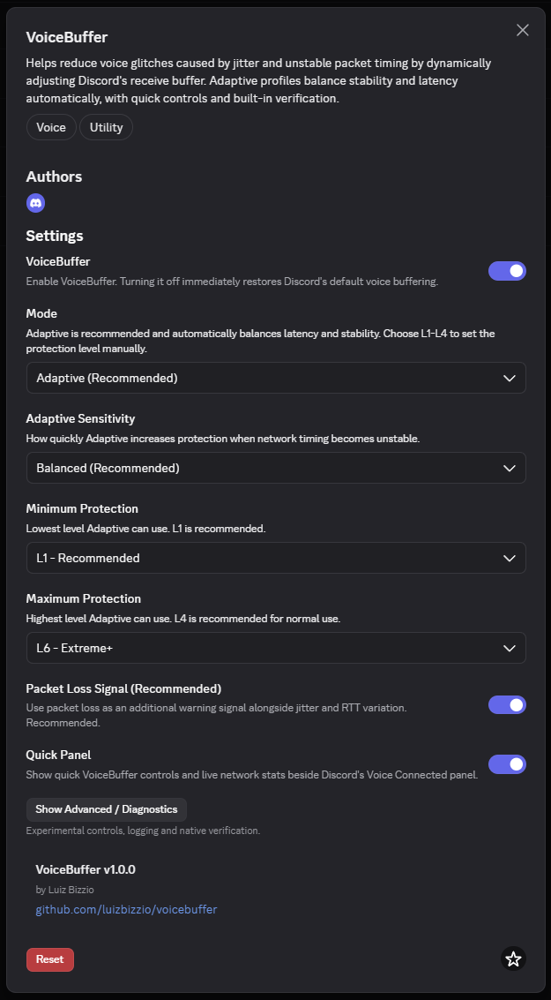

# VoiceBuffer

**Adaptive and manual buffering for incoming voice on Discord Desktop.** An experimental custom plugin for Vencord and Equicord.


When voice packets arrive unevenly, some reach Discord too late to play. VoiceBuffer can ask Discord to hold incoming voice a little longer, giving delayed packets more time to arrive. The trade-off is extra listening delay. The adjustment applies to the voice you hear in calls. Microphone transmission and screen-share playback are outside its scope.

> **Development paused.** This prototype targets Electron-based Discord Desktop.

## Install

You need Discord Desktop, Git, Node.js 22 or newer, and pnpm. VoiceBuffer is installed as a custom plugin in a Vencord or Equicord source build.

### 1. Open your Vencord or Equicord checkout

If you already build your client mod from source, open its repository in a terminal and go to step 2. For a fresh setup, run the block for the mod you use.

**Vencord**

```sh
git clone https://github.com/Vendicated/Vencord.git
cd Vencord
```

**Equicord**

```sh
git clone https://github.com/Equicord/Equicord.git
cd Equicord
```

### 2. Add VoiceBuffer and build

Run these commands from the root of your Vencord or Equicord checkout.

```sh
pnpm install --frozen-lockfile
git clone https://github.com/luizbizzio/voicebuffer.git src/userplugins/voicebuffer
pnpm build
```

The plugin entry point should be at `src/userplugins/voicebuffer/index.tsx`. If you prefer to copy a single file, place [`index.tsx`](index.tsx) at that path and run the build.

### 3. Install the build and enable the plugin

The first time you use a build from this checkout, run `pnpm inject` and select your Discord Desktop installation. If Discord already uses this checkout, a rebuild and full restart are enough. Open **User Settings → Plugins** in Vencord or Equicord, search for **VoiceBuffer**, and enable it. [Vencord build guide](https://docs.vencord.dev/installing/#installing-your-custom-build) · [Equicord build guide](https://docs.equicord.org/installing/#installing-your-custom-build)

Equicord development builds also offer **UserPluginInstaller**. Follow its instructions with this repository's URL if you already use it. [Equicord UserPluginInstaller guide](https://docs.equicord.org/installing/custom-plugin/#installing-plugins-via-userplugininstaller)

To update a Git-based installation, run `git -C src/userplugins/voicebuffer pull --ff-only`, rebuild, and restart Discord. To remove VoiceBuffer from your build, disable it, remove its folder from `src/userplugins`, rebuild, and restart.

## Use VoiceBuffer

Join a voice call and hover over **VB** beside Discord's voice controls. The Quick Panel can switch VoiceBuffer on or off and select **Auto** or **L1–L4**. It also shows ping, ping variation, packet loss, and `Min Buffer*` when available. Use the gear button or the plugin list to open the full settings, including **Custom (Advanced)**. If **VB** is missing, you can still use the plugin settings.

`Min Buffer*` is the minimum delay VoiceBuffer is requesting. Actual buffering can be higher. Hover over the value for the measured buffer when Discord exposes it.

### How the modes differ

VoiceBuffer changes two settings on the native connection. The **jitter level** is an internal Discord transport setting. The **minimum output delay** is the playback floor VoiceBuffer requests in milliseconds.

| Mode | Discord jitter level | Requested playback floor |
| --- | --- | --- |
| **Adaptive** (default) | Changes with network conditions, from L1 to L4 by default | Follows the rules for the current level |
| **L1 · Low Latency** | Holds L1 | 20–35 ms |
| **L2 · Balanced** | Holds L2 | 35–60 ms |
| **L3 · Stable** | Holds L3 | 50–90 ms |
| **L4 · Maximum Stability** | Holds L4 | 65–120 ms |
| **Custom (Advanced)** | Uses your **Custom Jitter Level** | Holds the value in **Custom Min Buffer**, from 0 to 200 ms |

The plugin combines media-engine statistics with recent Discord events to estimate jitter, changes in round-trip time, and optional packet loss. It writes the chosen jitter level through Discord's transport options and requests the playback floor through `setMinimumOutputDelay()` when available. [Mode logic](index.tsx#L1469-L1618) · [Native connection settings](index.tsx#L1678-L1729)

Keep **Postpone Decode** off for ordinary buffer tests. It changes decode scheduling independently of the buffer floor.

<a href="assets/voicebuffer-settings.png"></a>

_Example configuration with the Adaptive range set to L1–L6._

## Check whether it helps

**To check whether Discord responds to the request**, open the plugin settings during a call, click **Show Advanced / Diagnostics**, then click **Start Verification** under **Native Request Verification**. Keep the panel open and have another participant keep speaking. Once VoiceBuffer detects incoming audio, it spends about 24 seconds alternating between 0 and 200 ms while holding the jitter level at L0 and using Discord's default decode setting. The result reports the requested floor and, when available, Discord's target or the observed buffer. [Verification sequence](index.tsx#L1105-L1131)

**To compare audio**, restart Discord with VoiceBuffer disabled in the host's plugin list, then join a call for the baseline. In another run, choose **Custom (Advanced)**, set **Custom Jitter Level** to `0`, and try a **Custom Min Buffer** of 40 or 80 ms. Keep the source audio and packet-delay pattern the same across runs. Compare how much audio the receiver had to reconstruct and how much delay the buffer added, where those statistics are available. [WebRTC receiver metrics](https://www.w3.org/TR/webrtc-stats/#inboundrtpstats-dict)

The restart matters for baseline tests. Simulated tests found that pending stats could reapply the setting after shutdown and a failed reset to 0 ms could be skipped on retry.

## What was verified

- VoiceBuffer built and passed type checking with **Vencord 1.15.19** and **Equicord 1.15.18.2**. [Vencord build revision](https://github.com/Vendicated/Vencord/tree/d086992fb674299a2fa05ac6432edc3a777389f3) · [Equicord build revision](https://github.com/Equicord/Equicord/tree/8d63e9694b2ef5195806b3f8b2e03135a4b4ea2c)
- Static inspection of Discord Desktop **1.0.9269 on Windows** traced the plugin's delay request to the native receive jitter buffer. That interface can change between Discord builds. A reduction in audible cuts during real calls remains unverified.
- Serein and Discord's Project Phoenix desktop rewrite would need separate integrations. [Serein](https://github.com/ViceVerse-cz/Serein) · [Project Phoenix](https://www.youtube.com/watch?v=zgdPbgWaobQ)

See [CONTRIBUTING.md](CONTRIBUTING.md) for test cases and [LICENSE](LICENSE) for the GNU General Public License.
